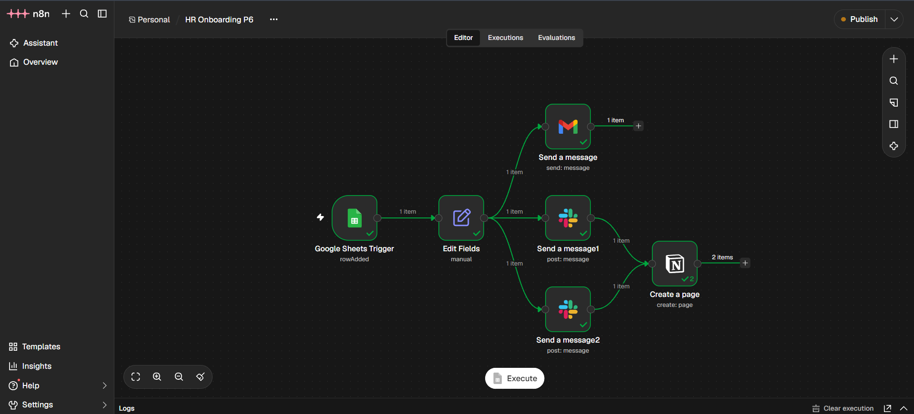
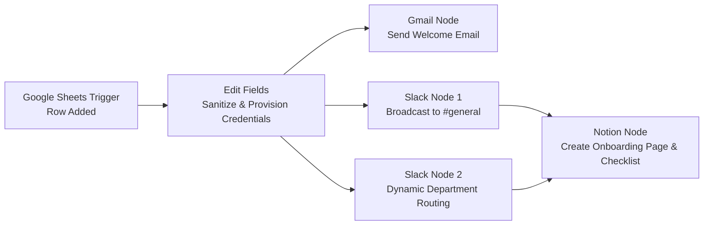

# 🚀 Automated HR Employee Onboarding & Provisioning Engine (n8n)

<p align="left">
  <a href="https://youtu.be/NP1CPghGqaQ?si=KGya5yAW2VGcMfS6" target="_blank">
    
  </a>
  
  
  
  
  
</p>

An end-to-end, production-ready **HR Onboarding & IT Provisioning Automation** built on **n8n**. Whenever a new hire submits their onboarding details through Google Forms/Sheets, this workflow automatically provisions corporate credentials, sends a personalized welcome email, broadcasts announcements to both `#general` and department-specific Slack channels, and generates a structured Notion onboarding checklist—eliminating repetitive manual HR tasks.

---

## 📑 Table of Contents

- [🎥 Video Demonstration](#-video-demonstration)
- [🎯 Problem Statement & Solution](#-problem-statement--solution)
- [🏗️ System Architecture & Data Pipeline](#️-system-architecture--data-pipeline)
- [✨ Key Features](#-key-features)
- [⚙️ Node-by-Node Technical Breakdown](#️-node-by-node-technical-breakdown)
- [📂 Repository Structure](#-repository-structure)
- [🛠️ Installation & Setup Guide](#️-installation--setup-guide)
- [🔧 Engineering Highlights & Troubleshooting](#-engineering-highlights--troubleshooting)
- [📬 Contact](#-contact)

---

## 🎥 Video Demonstration

Watch the complete end-to-end live walkthrough of this workflow in action—from Google Form submission to real-time Gmail delivery, dual-channel Slack notifications, and automated Notion page creation:

👉 **[Watch Full Project Demo on YouTube](https://youtu.be/NP1CPghGqaQ?si=KGya5yAW2VGcMfS6)**

[](https://youtu.be/NP1CPghGqaQ?si=KGya5yAW2VGcMfS6)

---

## 🎯 Problem Statement & Solution

| Manual HR Bottleneck | Automated n8n Solution |
| :--- | :--- |
| Manually creating corporate emails and sharing temporary credentials | Auto-generates standardized `firstname.lastname@yourcompany.com` addresses and temporary passwords |
| Delayed welcome emails to newly hired employees | Instant, personalized HTML/text welcome emails dispatched via Gmail |
| Forgetting to announce new hires in both company-wide and team channels | Parallel Slack execution posting simultaneously to `#general` and dynamic department channels (`#sales`, `#marketing`, `#engineering`) |
| Inconsistent first-week task tracking across departments | Auto-provisioned Notion onboarding page with role metadata, credentials, and an interactive 4-step To-Do checklist |

---

## 🏗️ System Architecture & Data Pipeline

To prevent item-pairing loss across sequential API calls, the workflow uses a **parallel branching architecture** directly from the `Edit Fields` transformation node:



---

## ✨ Key Features

- **⚡ Real-Time Event Trigger:** Listens to `Form_Responses` in Google Sheets and triggers automatically upon every new row addition (`rowAdded`).
- **🔐 Dynamic Credential Generation:** Normalizes full names into lowercase dot-separated corporate email IDs and assigns default onboarding credentials.
- **📧 Automated Gmail Onboarding:** Delivers a formatted welcome email containing role details, start date, corporate email, and temporary password to the employee's personal inbox.
- **💬 Dual-Channel Slack Broadcasting:**
  - **Company-Wide (`#general`):** Introduces the new team member to the entire organization.
  - **Department-Specific (`#sales`, `#marketing`, `#engineering`, etc.):** Dynamically resolves the target channel name from the employee's department field and notifies their immediate team.
- **📝 Structured Notion Onboarding Hub:** Creates a dedicated child page under the HR `Employee Onboarding` workspace with structured headings, account credentials, and a 4-item first-week checklist.

---

## ⚙️ Node-by-Node Technical Breakdown

| Step | Node Name | Type | Core Logic / Expression Used |
| :--- | :--- | :--- | :--- |
| **1** | `Google Sheets Trigger` | Trigger (`rowAdded`) | Polls `New Joining Onboard` (`Form_Responses`) for new employee entries |
| **2** | `Edit Fields` | Set / Transform | `corporate_email`: `{{ $json['Full Name (কর্মীর নাম)'].toLowerCase().replace(' ', '.') }}@yourcompany.com` |
| **3** | `Send a message` | Gmail | Sends personalized onboarding email to `{{ $json['Personal Email (কর্মীর ব্যক্তিগত ইমেইল)'] }}` |
| **4** | `Send a message1` | Slack | Posts formatted announcement to static `#general` channel |
| **5** | `Send a message2` | Slack | Dynamically routes to channel: `{{ $json['Department '].toLowerCase().trim() }}` |
| **6** | `Create a page` | Notion | Creates `Onboarding Page - {{ $('Edit Fields').item.json['Full Name (কর্মীর নাম)'] }}` with 9 structured content & To-Do blocks |

---

## 📂 Repository Structure

```text
n8n-hr-onboarding-automation/
├── assets/
│   ├── workflow-architecture.png    # Complete n8n canvas execution screenshot
│   ├── slack-announcement.png       # Formatted Slack team announcement preview
│   └── notion-onboarding-page.png   # Generated Notion onboarding checklist preview
├── data/
│   └── sample-form-responses.csv    # Sample Google Sheets schema & test records
├── docs/
│   └── setup-guide.md               # Step-by-step OAuth scopes & node setup notes
├── workflows/
│   └── hr-onboarding-workflow.json  # Exported n8n workflow ready for import
├── .env.example                     # Template for required environment variables
├── .gitignore                       # Standard Git ignore rules for secrets & OS files
└── README.md                        # Project documentation
```

---

## 🛠️ Installation & Setup Guide

### 1. Prerequisites
- A running **n8n** instance (Self-hosted via Docker/Desktop or n8n Cloud).
- Active accounts and API credentials for **Google Sheets**, **Gmail**, **Slack**, and **Notion**.

### 2. Import the Workflow
1. Clone this repository:
   ```bash
   git clone [https://github.com/fhm16/n8n-hr-onboarding-automation.git](https://github.com/fhm16/n8n-hr-onboarding-automation.git)
   cd n8n-hr-onboarding-automation
   ```
2. Open your n8n dashboard and create a new workflow.
3. Click **`...` (More)** $\rightarrow$ **Import from File** and select `workflows/hr-onboarding-workflow.json`.

### 3. Configure Credentials & Permissions
- **Google Sheets & Gmail:** Connect your Google OAuth2 credentials and select your target spreadsheet (`Form_Responses`).
- **Slack App Scopes:** Ensure your Slack Bot Token has `chat:write` and `chat:write.public` permissions enabled, and create public department channels (`#general`, `#sales`, `#marketing`, `#engineering`).
- **Notion Integration:** Share your parent `Employee Onboarding` Notion page with your n8n Notion integration connection.

### 4. Activate
Save the workflow and toggle the status switch from **Inactive** to **Active**.

---

## 🔧 Engineering Highlights & Troubleshooting

- **Preserving `$json` Context via Parallel Branching:** Routing both Slack nodes directly from `Edit Fields` rather than chaining them sequentially prevents Slack API response payloads (`ok`, `ts`, `channel`) from overwriting upstream employee fields.
- **Sanitizing Dynamic Channel Names:** Using `.toLowerCase().trim()` on department values ensures clean Slack channel resolution even when form responses contain uppercase letters or trailing spaces.

---

## 📬 Contact

Have questions, feedback, or want to collaborate on workflow automation projects? Feel free to reach out:

- **Author:** Ferdous Hasan Maruf
- **Email:** [ferdoushasanmaruf16@gmail.com](mailto:ferdoushasanmaruf16@gmail.com)
- **GitHub:** [@fhm16](https://github.com/fhm16)
- **Project Demo:** [YouTube Walkthrough](https://youtu.be/NP1CPghGqaQ?si=KGya5yAW2VGcMfS6)